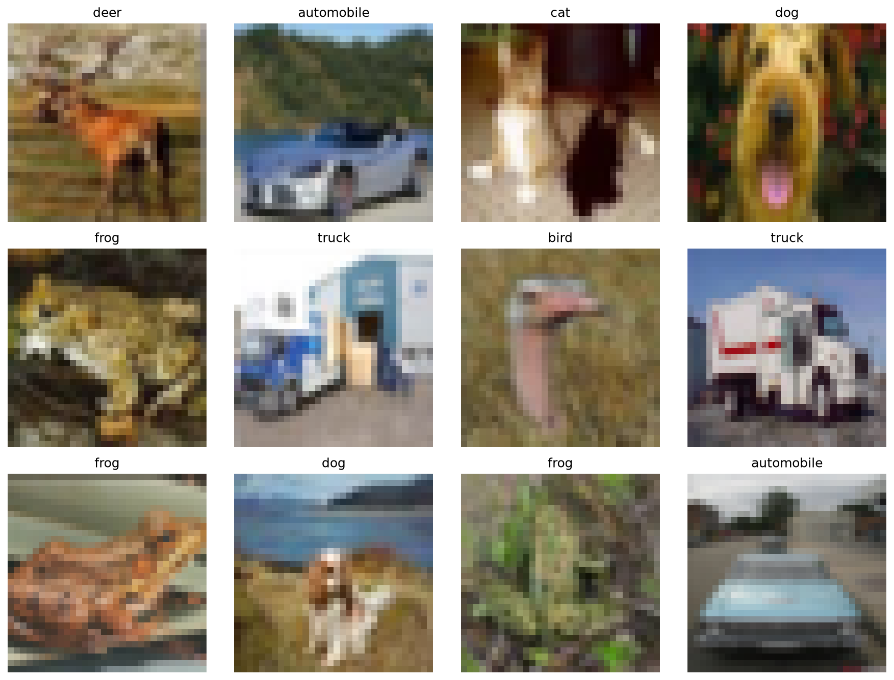
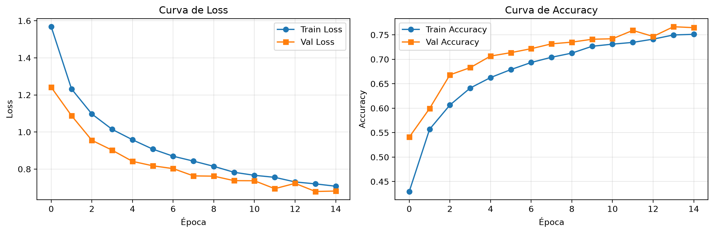
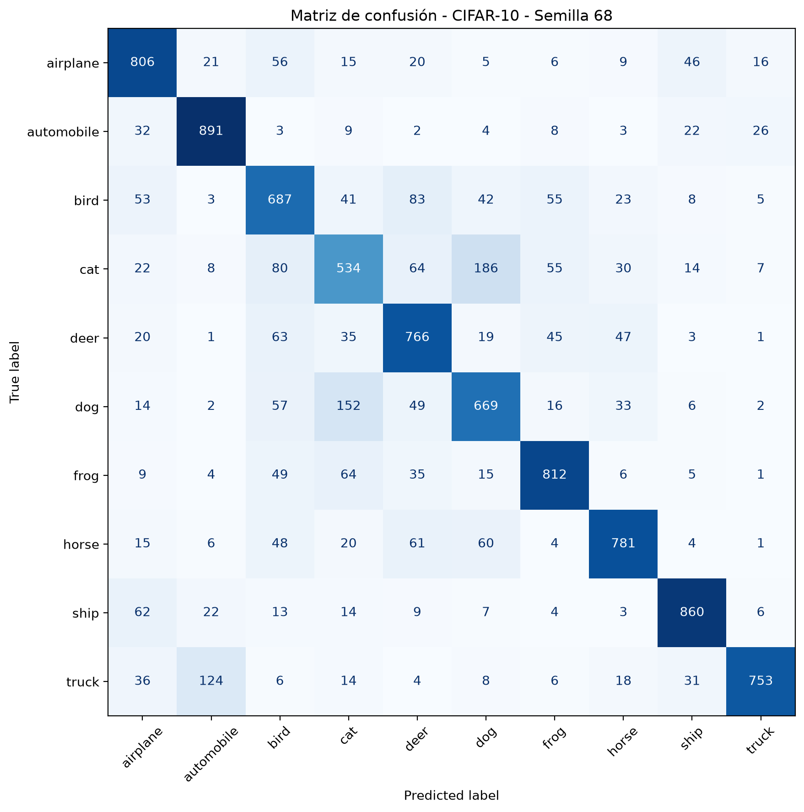

# Evaluación de la Segunda Unidad — Clasificación CIFAR-10 con CNN

**Universidad Andina del Cusco**  

## Datos 

- **Estudiante:** Kelma Ivonne Leva Ayte
- **Código de matrícula:** 016100868f
- **Semilla individual:** **68** 
- **Docente:** Lazo Mamani, Juan Carlos
- **Curso:** Inteligencia Artificial

> La semilla 68 se aplica mediante `torch.manual_seed(68)`, `np.random.seed(68)` y `random.seed(68)` para garantizar la reproducibilidad de la mezcla, partición y pesos iniciales.

---

## Estructura del repositorio

```text
nombre_repositorio/
├── src/
│   ├── dataset.py
│   ├── model.py
│   └── train.py
├── notebooks/
│   └── experiment.ipynb
├── outputs/
│   ├── samples.png
│   ├── loss_accuracy.png
│   └── confusion_matrix.png
└── README.md
```

---

## Requisitos y ejecución

```bash
pip install torch torchvision numpy matplotlib scikit-learn jupyter
```

Desde la raíz del repositorio:

```bash
python src/dataset.py
python src/model.py
python src/train.py
jupyter notebook notebooks/experiment.ipynb
```

Al ejecutar `src/train.py` se generan automáticamente los artefactos gráficos en la carpeta `outputs/`.

---

## Pregunta 1: Carga, visualización, transformaciones y partición con semilla

A continuación se muestra la cuadrícula con 12 imágenes de ejemplo extraídas del conjunto de entrenamiento de CIFAR-10, indicando claramente la clase o etiqueta real de cada fotografía:



En `src/dataset.py` se implementa lo siguiente:

1. **Carga y semilla:** Se carga el dataset CIFAR-10 utilizando `torchvision.datasets.CIFAR10`. Se fija la semilla individual **68** con `torch.manual_seed(68)` y `np.random.seed(68)`, garantizando la reproducibilidad de los pesos iniciales y de la partición.
2. **Visualización:** La función `visualize_cifar10_samples()` muestra una cuadrícula de 12 imágenes de ejemplo con su respectiva etiqueta real en el título.
3. **Pipeline de transformaciones:** Se utiliza `torchvision.transforms` con las siguientes técnicas:
   - `ToTensor()` (conversión a tensor).
   - `Normalize()` (normalización de canales RGB).
   - Aumento de datos: `RandomCrop(32, padding=4)` y `RandomHorizontalFlip()`.
4. **Partición Estratificada:** Utilizando `train_test_split` de `sklearn` con `stratify=targets`, se divide el conjunto de entrenamiento en:
   - **Entrenamiento:** 40,000 imágenes.
   - **Validación:** 10,000 imágenes.
   - **Test:** 10,000 imágenes.
   Estas dimensiones se imprimen explícitamente en consola al ejecutar el script, demostrando la correcta manipulación de los lotes con `torch.Size([64, 3, 32, 32])`.

---

## Pregunta 2: Diseño arquitectónico y justificación estructural CNN frente a MLP

### Justificación Teórica
Un **Perceptrón Multicapa (MLP)** aplicado a CIFAR-10 requiere aplanar la imagen de `32x32x3` en un vector de 3072 elementos. Esto destruye la estructura espacial bidimensional (los píxeles adyacentes pierden su relación de vecindad). Además, una capa densa inicial requeriría una cantidad masiva de parámetros, provocando sobreajuste (overfitting) e ineficiencia computacional. Un MLP carece de invariancia espacial.

Por otro lado, las **Redes Neuronales Convolucionales (CNN)** resuelven esto mediante:
- **Conectividad local:** Cada neurona convolucional se conecta solo a una pequeña región de la imagen.
- **Compartición de pesos:** Un mismo filtro se desliza por toda la imagen, reduciendo drásticamente los parámetros.
- **Invariancia espacial:** La combinación de convoluciones y pooling permite reconocer patrones (bordes, texturas, formas) independientemente de su posición exacta en la imagen.

### Especificación de la Arquitectura
La red implementada en `src/model.py` cuenta con la siguiente estructura:

| Etapa | Capa / Operación | Shape de salida |
|---|---|---|
| Entrada | Imagen RGB | `(B, 3, 32, 32)` |
| Bloque Conv 1 | `Conv2d(3, 32, kernel_size=3, padding=1)` + `ReLU` | `(B, 32, 32, 32)` |
| Pool 1 | `MaxPool2d(2, 2)` | `(B, 32, 16, 16)` |
| Bloque Conv 2 | `Conv2d(32, 64, kernel_size=3, padding=1)` + `ReLU` | `(B, 64, 16, 16)` |
| Pool 2 | `MaxPool2d(2, 2)` | `(B, 64, 8, 8)` |
| Aplanado | `Flatten()` | `(B, 4096)` |
| Densa 1 | `Linear(4096, 128)` + `ReLU` | `(B, 128)` |
| Salida | `Linear(128, 10)` | `(B, 10)` |

---

## Pregunta 3: Manipulación rigurosa de tensores 4D y validación de forward pass

En `src/model.py` se define el método `forward()` de la CNN, el cual recibe correctamente tensores 4D `(Batch_Size, Channels, Height, Width)`.

Se incluye una **validación de shapes (aserción)** que se ejecuta si se corre el archivo directamente. Se pasa un lote simulado `(4, 3, 32, 32)` a través de la red, imprimiendo las dimensiones intermedias en consola y terminando con un `assert` que asegura que la salida sea `(4, 10)`.

Salida en consola:
```text
Input: (4, 3, 32, 32)
features[0] - Conv2d: (4, 32, 32, 32)
features[1] - ReLU: (4, 32, 32, 32)
features[2] - MaxPool2d: (4, 32, 16, 16)
features[3] - Conv2d: (4, 64, 16, 16)
features[4] - ReLU: (4, 64, 16, 16)
features[5] - MaxPool2d: (4, 64, 8, 8)
Flatten: (4, 4096)
Linear 1: (4, 128)
ReLU: (4, 128)
Linear 2 / Output: (4, 10)
Forward pass OK. Output final: (4, 10)
```

---

## Pregunta 4: Ciclo de entrenamiento, métricas y análisis crítico

### Configuración y Entrenamiento
En `src/train.py` se implementa el ciclo completo:
- **Optimizador:** `Adam` con una tasa de aprendizaje de `1e-3`.
- **Función de pérdida:** `CrossEntropyLoss`.
- **Épocas:** 15 (guardando el mejor modelo según la exactitud de validación).
- **Bucle:** Se registran iterativamente las métricas de `Loss` y `Accuracy` para entrenamiento y validación.
- **Artefactos:** Se generan y guardan automáticamente en `outputs/` las gráficas `loss_accuracy.png` (curvas de aprendizaje) y `confusion_matrix.png` (matriz de confusión sobre el conjunto de test).

### Análisis Crítico de las Métricas (Semilla 68)

- **Accuracy final de entrenamiento:** `0.7511`
- **Accuracy final de validación:** `0.7647`
- **Accuracy en Test:** `0.7559`
- **Loss de entrenamiento final:** `0.7075`
- **Loss de validación final:** `0.6814`

**Interpretación:**
Al analizar las métricas, observamos un comportamiento sumamente saludable: el *Accuracy* de validación (76.47%) es ligeramente superior al de entrenamiento (75.11%). Esto ocurre debido al uso de **Data Augmentation** (recortes y volteos aleatorios) durante la fase de entrenamiento, lo cual hace que el modelo aprenda de imágenes más difíciles. En validación y test, las imágenes se evalúan sin estas perturbaciones, lo que facilita una precisión ligeramente mayor.

Esto indica que el modelo **no presenta síntomas de overfitting** (sobreajuste), ya que no hay una brecha negativa entre entrenamiento y validación, y las curvas de *Loss* descienden de forma paralela y estable. Tampoco hay síntomas de *underfitting* (subajuste), ya que el modelo logra aprender y superar ampliamente el rendimiento de un clasificador aleatorio (10%), alcanzando un **75.59% de precisión en el conjunto de Test**.

Por otro lado, la **matriz de confusión** evidencia que las clases con mayor tasa de acierto son `ship` y `automobile`, mientras que las confusiones más frecuentes ocurren entre clases visualmente similares, como `cat` y `dog` o `deer` y `horse`, lo cual es completamente esperado en imágenes de baja resolución (32x32).





---
